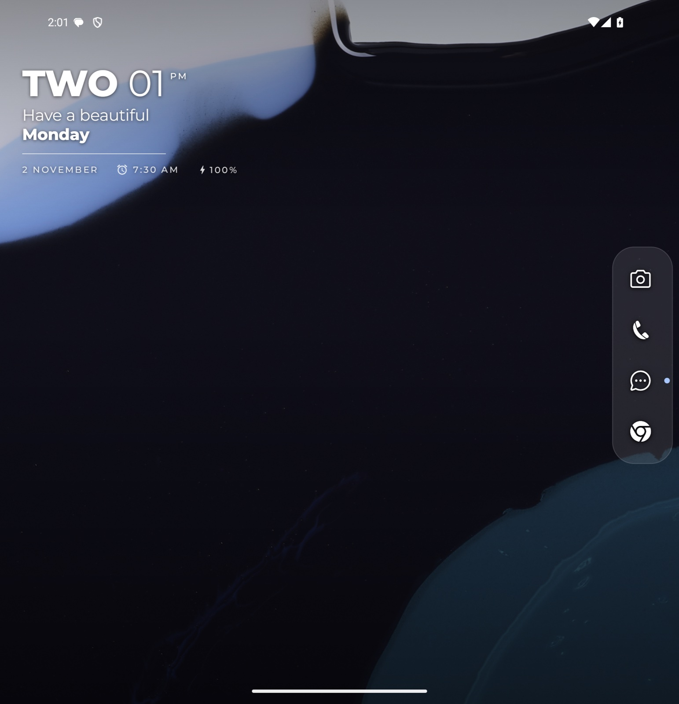
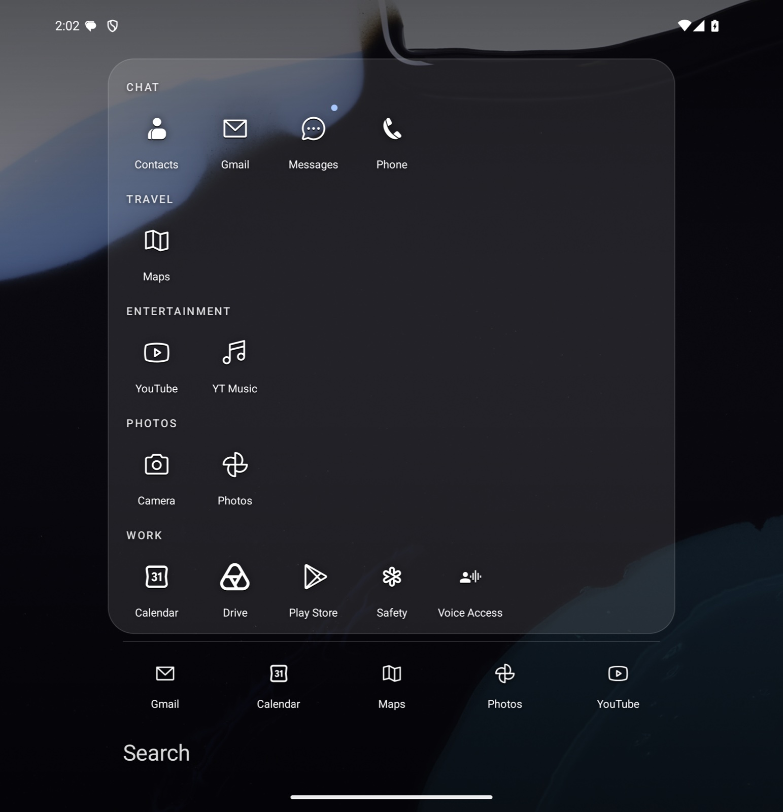
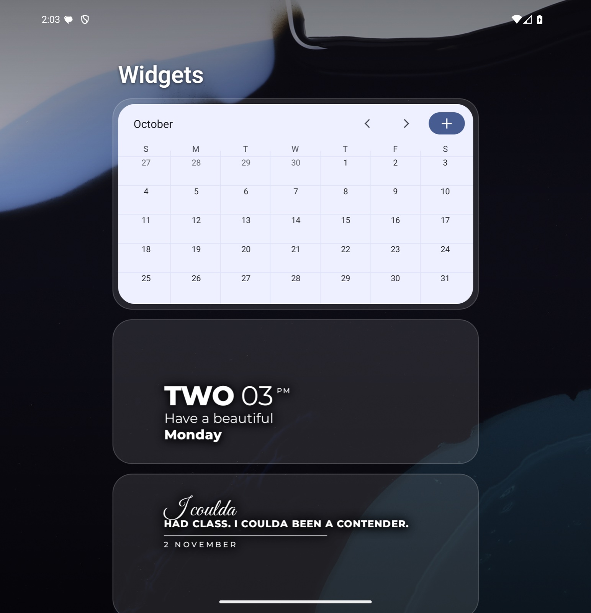
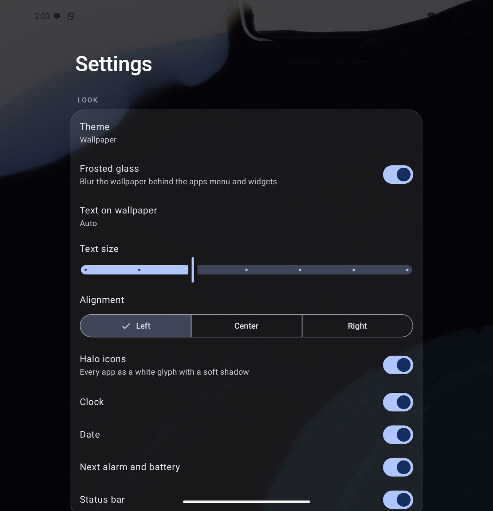

# Fluid

A minimal Android launcher built for the Galaxy Z Fold 7: a calm text-first home with a Mac-style icon
dock on the right, real widgets, and gestures that follow your finger at 120 Hz instead of jumping
between screens. No accounts, no network permission, no analytics.



## Why

Olauncher gets the calm right but refuses widgets, pinned shortcuts and split screen. One UI Home has
all of those and buries them under pages, folders and a Discover feed. Most third-party launchers
animate between fixed states, so a swipe feels like pressing a button. Fluid is the small home screen
in between: one page, the clock, a dock, and every gesture tracking the finger the whole way.

## What it does

- **One page, two screens.** The same composition runs on the cover (~411 dp) and inner (~750 dp)
  screens, so folding never recreates widget views or reloads the home.
- **A dock that magnifies.** Favourites sit in a glass pill on the right edge and grow under your finger
  like the macOS dock. Slide along it and let go to open. An entry can be an app pair that opens in split screen.
- **Search that reads your mind a little.** Prefix beats word-start beats initials ("gm" finds Google Maps)
  beats substring, ties go to the most-launched app. It also finds app shortcuts ("new tab"), 29 Settings
  pages by everyday words ("internet" opens Wi-Fi) and contacts ("call sam", "text sam").
- **Apps grouped for you.** The drawer sorts apps into Social, Chat, Money, Shopping, Food, Travel,
  Entertainment, Photos, Games, Work and Tools from package and name keywords, with your five
  most-launched apps in a row above the search bar.
- **Halo icons.** Every app as a white Phosphor glyph with a soft shadow, matched by package name, then the
  app's own themed icon, then a word in its name, then its first letter.
- **Widgets that behave.** A vertical widgets page with resize, reorder and reconfigure, live previews in the
  picker, and the system corner radius clipped onto the widget's own view.
- **Frosted glass.** The wallpaper blurs as far as the drawer is open. Samsung turns Android's public window
  blur off, so Fluid calls One UI's own blur by reflection and falls back to a dark scrim elsewhere.
- **Pinning from other apps.** Chrome "Add to home screen", PWAs and other apps' "add widget" buttons all land
  on the home.

## Screenshots

| | |
|---|---|
|  |  |
| Home | Apps |
|  |  |
| Widgets | Settings |

*Screenshots come from a stock Pixel 9 Pro Fold emulator via `Tools/screenshots.sh`: the default wallpaper and
apps, nobody's actual phone.*

## Quick start

Requirements: JDK 21, the Android SDK (compileSdk 37), a phone on Android 12 or later with USB debugging on.

```bash
git clone https://github.com/aaryann123/fluid-launcher && cd fluid-launcher
echo "sdk.dir=$ANDROID_HOME" > local.properties
npm run dev        # builds the release APK, installs it, pre-compiles it for full speed
```

Then press home and pick **Fluid**, **Always**. For double-tap to lock, turn Fluid on under
**Settings, Accessibility, Installed apps**; on a sideloaded APK it may first need **Apps, Fluid, Allow
restricted settings**. No cable: `npm run apk` writes `Fluid.apk` to copy over and open.

On a Samsung, turn **Auto Blocker** off first; it blocks USB installs.

| Gesture | Does |
|---|---|
| Swipe up | All apps; type to search, Enter opens the top match |
| Swipe down | Notifications |
| Swipe left | Your swipe-left app (camera by default); keep pulling for a second app (phone) |
| Swipe right | Widgets |
| Double-tap | Lock |
| Long-press empty space | Add widget, wallpaper, settings |
| Long-press a dock icon | Drag to reorder, or let go for rename / remove |
| Long-press an app | Its shortcuts, split screen, add to home, rename, hide, uninstall |

## Requirements

| | |
|---|---|
| Phone | Android 12+ (minSdk 31). Tuned on a Galaxy Z Fold 7 with One UI 9; other phones work, without Samsung's blur |
| Build | JDK 21, Android Gradle Plugin 9.4, Kotlin 2.4 Compose compiler |
| UI | Jetpack Compose (BOM 2026.09), no AppCompat |
| Signing | The release build uses the debug key, so it installs without a keystore. Make your own key before sharing an APK |
| Node | Only to run the `npm` script shortcuts; `./gradlew :app:installRelease` works without it |

## How it's organised

```
app/src/main/java/app/fluid/launcher/
  MainActivity.kt     the home activity, gesture state, lifecycle
  Home.kt             clock, dock, wallpaper theme, the pane container
  Drawer.kt           apps grid, search results, the long-press menu
  Widgets.kt          widget host, picker, resize and reorder
  Apps.kt Search.kt   app list, shortcuts, Settings pages, ranking
  Halo.kt             package -> glyph icons
  Store.kt            one SharedPreferences file mirrored into Compose state
Tools/                glyph fetcher, screenshot script
docs/                 ARCHITECTURE.md, BUILDING.md, DESIGN.md
```

[docs/ARCHITECTURE.md](docs/ARCHITECTURE.md) explains how it works and what bit along the way;
[docs/BUILDING.md](docs/BUILDING.md) covers building, testing and adding things.

## Contributing

Pull requests are welcome.

- `npm test` runs the unit tests (search ranking, categories, dock, Halo glyphs, clock). Run them before a PR.
- New Halo icon: add `"package" to "glyph"` to `GLYPHS` in `Halo.kt`, then `python3 Tools/glyphs.py`.
  For apps only you use, put them in the gitignored `app/src/main/assets/glyph-map.txt` instead.
- Screenshots come from the emulator script, never from a personal phone.
- Good first projects: icon pack support, a non-Samsung blur path tested on a Pixel, per-screen dock sizes.

## Credits and licence

Fluid is MIT licensed, see [LICENSE](LICENSE).

- [Montserrat](https://github.com/JulietaUla/Montserrat) by Julieta Ulanovsky and contributors, SIL Open Font
  License 1.1 ([licenses/OFL.txt](licenses/OFL.txt)).
- [Phosphor Icons](https://phosphoricons.com) 2.1.1 path data in `assets/glyphs.txt`, MIT.
- Design ideas from [Olauncher](https://github.com/tanujnotes/Olauncher) (no code copied).
- Galaxy, One UI and Samsung are trademarks of Samsung Electronics; app names in `Halo.kt` belong to their owners.
